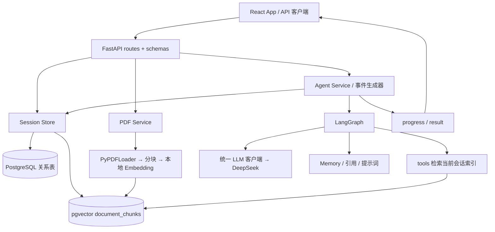

<!-- 本地进行中迁移状态以 LOCAL_STORAGE.md / TASKS.md 为准，未发布。 -->
# 系统架构与当前边界

更新时间：2026-11-16 18:58（Asia/Shanghai）。依据代码基线 `4d4e55b` 及本地 T02a 异常披露修复；描述现状，不表示在线实例已重新验证或发布。改造目标与状态见 [路线图](../plans/ROADMAP.md) 和 [任务清单](../plans/TASKS.md)。

## 1. 模块化单体

生产入口是 [app/main.py](../app/main.py)：FastAPI 提供 API，构建后还托管 `frontend/dist`。开发时 Vite 独立运行。LangGraph、检索和存储在同一后端进程内工作，没有任务队列或独立向量数据库服务。现有本地持久化适合先按单实例维护，不能据此推断已支持多 worker 或多副本共享写入。

关键依赖职责：LangGraph 编排状态；LangChain 提供 Document、PDF loader、切分、Embedding 适配；OpenAI SDK 访问 DeepSeek；SQLAlchemy/psycopg 保存 PostgreSQL 会话；ReactMarkdown/GFM 展示回答。版本来源是 [requirements.api.txt](../requirements.api.txt)、[package.json](../frontend/package.json) 与前端 lockfile。Python 主要使用最低版本约束，尚非完整可复现锁定。

## 2. API 与上传数据流

[routes.py](../app/api/routes.py) 提供 `/health`、创建/读取/删除 `/sessions`、上传 `/sessions/{session_id}/pdfs`、普通 `/ask` 与 `/ask/stream`。精确请求响应以 [schemas](../app/schemas/requests.py)、[响应模型](../app/schemas/responses.py) 和运行时 `/openapi.json` 为准，本文不复制字段表。

上传路径见 [pdf_service.py](../app/services/pdf_service.py) 的 `load_pdf_into_session`：读取文件全部字节 → 临时文件 → `parse_pdf_documents` → `split_documents` → BGE-M3 编码 → 同事务写入文档、Chunk 和会话页数 → finally 删除临时文件。相同文件名会跳过；`document_count` 累加 PDF 页级 Document 数量，不是 chunk 数量。多文件上传逐个提交，后续文件失败不能回滚之前的成功项。

- 当前仅按文件名后缀检查 PDF；问题仅有非空最小长度校验。
- 未实现应用层认证/所有权、请求限速、PDF 字节/页/chunk 限额及统一工作流费用预算；CORS 不是权限控制。上游平台是否另有限制待验证。
- 解析、Embedding 和入库在工作线程执行；模型计算不占数据库连接。上传仍一次读取全部字节，资源限额未解决。
- 原始 PDF 临时文件被删除，但索引包含文本片段，PostgreSQL/浏览器也保留会话数据，不能称为“处理后不留数据”。

## 3. Agent 状态与执行

[agent/state.py](../agent/state.py) 定义 `AgentState` 与初值，包括问题、steps/completed_steps、答案、检索结果、协作建议、revision_count、timings、vectorstore、文件名及历史。部分字段仍是 `Any`，TypedDict 不提供运行时模型输出校验。

[graph_agent.py](../agent/graph_agent.py) 的主路径：

1. Planner 先规则匹配，不能确定时使用 LLM；具体回退见 [llm_planner.py](../agent/llm_planner.py)。
2. 待执行 QA、Summary、Compare、Source、Keyword 可在线程池并行，单次最多五个；`copy_context` 传播用量上下文，结果按步骤顺序汇总。
3. 单 Specialist 走 Reviewer 快路径，Source 直接由检索结果生成引用，不需要模型。其他生成步骤使用共享 LLM 客户端。
4. 多 Specialist 进入 Collaboration；revision controller 最多一次增加尚未执行的步骤，并非任意次数重试原步骤。之后 Reviewer 合成最终回答。

编译后的 Graph 在 [agent_service.py](../app/services/agent_service.py) 缓存，单次请求创建状态与 UsageTracker。Graph 未配置持久化 checkpoint；PostgreSQL 的历史持久化不等于工作流断点恢复。Specialist 失败使用固定安全提示，Reviewer 异常会拼接已有结果；部分失败状态在汇总时仍会丢失。LLM 返回结构仍需更严格验证。

普通回答和 SSE 共用 `iter_pdf_agent_events`。SSE 是 `progress` 与最终 `result` 事件，不是逐 Token 模型流。当前服务层另有下一节点推断逻辑；Graph 异常后仍可能保存错误文本并记录 completed；保存异常也可能中断流。客户端断线是否停止上游调用未验证，不能承诺取消后不再产生费用。

## 4. 检索、引用与 Memory

[text_splitter.py](../utils/text_splitter.py) 保留 1200 字符块、250 字符重叠。[embeddings.py](../utils/embeddings.py) 固定 BGE-M3 revision、CPU FP32、1024 维单位向量；运行时仅用缓存，缺失即失败。[pgvector_store.py](../utils/pgvector_store.py) 使用共享连接池和精确 cosine 检索，先限定会话及 profile，再排序取 top-k。未启用 HNSW。

| 工具 | 当前检索方式 | 边界 |
| --- | --- | --- |
| QA、Source | 用户问题，`k=3` | 无分数阈值，可能遗漏跨页证据 |
| Summary、Compare | 固定主题查询，`k=30`，每文件最多取三块 | 全库候选不保证每份文档都有结果，未按当前问题定制检索 |
| Keyword | 固定关键词查询，`k=10` | 代表性受候选召回限制 |

上述实现见 [tools/](../tools)。查询中的 session/profile 过滤及复合 FK 提供数据范围隔离，但会话 ID 的保密不等同于已实现用户所有权校验。

[citations.py](../utils/citations.py) 从 source 和零基 page 产生文件名及一基物理 PDF 页码；[agent_service.py](../app/services/agent_service.py) 去重并返回最多 800 字符的来源摘要。返回来源是检索结果集合，不证明最终每句话都被证据支持。

[deepseek_client.py](../utils/deepseek_client.py) 先放稳定系统指令、可复用文档上下文，再放动态 Memory 和问题。[memory.py](../utils/memory.py) 组合最近十条历史、较早历史的模型摘要、已上传文件名；摘要缓存当前无淘汰策略，锁内模型请求可能阻塞其他摘要。未做完整提示注入鲁棒性验证。

## 5. PostgreSQL 持久化与生命周期

session_store 保留原服务入口，转接 postgres_store。sessions、session_messages、session_documents 和 document_chunks 由 Alembic 管理。会话读取刷新 UTC 秒级时间；消息按批次幂等追加并使用父会话行锁，文档和向量同事务提交。删除/TTL 依赖 FK 级联，不扫描或删除历史 FAISS 目录。

当前本地迁移按用户要求关闭 SESSION_RETENTION_ENABLED。启用后的 TTL 边界仍为 updated_at <= now - TTL；恢复清理需用户确认。迁移与恢复工具、独立数据库及启动命令见 [LOCAL_STORAGE.md](LOCAL_STORAGE.md)。旧 SQLite/FAISS 保留；FAISS 只通过独立迁移依赖安装，API、原型和真实 PDF 评估均使用 pgvector。

## 6. 前端与可观测性

[App.tsx](../frontend/src/App.tsx) 用 Hooks 管理会话、文档、聊天和工作流状态，localStorage 保存本地会话内容；三个面板负责展示。[api.ts](../frontend/src/api.ts) 封装 fetch 和 POST SSE 解析，[types.ts](../frontend/src/types.ts) 定义共享类型，[i18n.ts](../frontend/src/i18n.ts) 管理双语。TypeScript strict 已启用；网络数据主要靠类型断言，尚无完整运行时验证或请求取消机制。恢复会话时网络错误与不存在的会话未充分区分。

[observability.py](../utils/observability.py) 以请求上下文记录 JSON 日志、耗时、按模型/操作汇总用量，并区分缓存真实零命中、不可用和无调用。[pricing.py](../utils/pricing.py) 按调用开始时间选择北京时间峰谷价；USD/CNY 使用独立表，环境变量覆盖的是 USD 峰值单价。价格表注明核实日期，本文不将它宣称为实时价格；[节假日数据](../utils/china_holidays.json) 目前只覆盖 2026 年，未知年份潜在峰时估价不可用。

评估分别汇总 Agent/Judge/total usage，Judge 失败保留已记录用量。失败且供应商未给用量时成本未知。T02a 将 LLM、Specialist、Collaboration 和 Graph 异常出口改为固定安全提示；JsonFormatter 的异常字段只记录类型、模块/函数/行号及原因链，省略异常正文、绝对路径与源码行，保留请求关联。会话 ID、请求路径、任意日志 message/structured_fields、其他日志处理器及本地评估报告仍需单独隐私审查；这不是全链路内容脱敏。长期指标聚合和告警系统仍未确认。

## 7. 测试与交付边界

[evaluation/runner.py](../evaluation/runner.py) 有规则路由、受控 live、真实 PDF 三种模式。真实模式复用生产解析、切分、BGE-M3、pgvector 和 Graph；Judge 单独接收参考事实。语义标注仍是待人工复核参考，引用集合匹配不等于事实准确性。命令和结果解释见 [TESTING.md](TESTING.md)。

Docker 多阶段构建前端，以非 root 运行 API并预缓存 Embedding。Compose 持久化 `/data`；[render.yaml](../render.yaml) 描述单服务、持久磁盘与手动部署。CI 构建镜像但不运行容器健康冒烟。Docker 健康检查写死 8000，而启动支持 `PORT`；调整端口时需同步处理。容器依赖/基础镜像/模型快照尚未全部锁定。在线配置、备份效果、并发容量和当前依赖漏洞适用性均需专项验证，不能由仓库配置推出结论。
