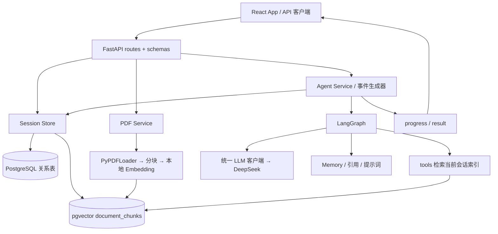

<!-- 本地进行中迁移状态以 LOCAL_STORAGE.md / TASKS.md 为准，未发布。 -->
# 系统架构与当前边界

更新时间：2026-11-25（Asia/Shanghai，同容器 PostgreSQL 部署边界）。线上发布和验证状态见 [任务清单](../plans/TASKS.md)，长期方向见 [路线图](../plans/ROADMAP.md)。

## 1. 模块化单体

生产入口是 [app/main.py](../app/main.py)：FastAPI 提供 API，构建后还托管 `frontend/dist`。开发时 Vite 独立运行。LangGraph、检索和存储在同一后端进程内工作，没有任务队列或独立向量数据库服务。现有本地持久化适合先按单实例维护，不能据此推断已支持多 worker 或多副本共享写入。

关键依赖职责：LangGraph 编排状态；LangChain 提供 Document、PDF loader、切分、Embedding 适配；OpenAI SDK 访问 DeepSeek；SQLAlchemy/psycopg 保存 PostgreSQL 会话；ReactMarkdown/GFM 展示回答。版本来源是 [requirements.api.txt](../requirements.api.txt)、[package.json](../frontend/package.json) 与前端 lockfile。Python 主要使用最低版本约束，尚非完整可复现锁定。

## 2. API 与上传数据流

[routes.py](../app/api/routes.py) 提供 `/health`、创建/读取/删除 `/sessions`、上传 `/sessions/{session_id}/pdfs`、普通 `/ask` 与 `/ask/stream`。精确请求响应以 [schemas](../app/schemas/requests.py)、[响应模型](../app/schemas/responses.py) 和运行时 `/openapi.json` 为准，本文不复制字段表。

上传路径见 [input_limits.py](../app/input_limits.py) 与 [pdf_service.py](../app/services/pdf_service.py)：每进程请求准入、请求体字节/空闲/累计读取期限 → 全批文件名/字节预检 → 单个工作线程分块复制到临时文件、页数预检、逐页文本限额、分块限额 → BGE-M3 编码 → 同事务写入文档、Chunk 和会话页数 → 删除临时文件并释放额度。上传路由通过工作线程读取会话，不阻塞事件循环。问答 JSON/SSE 共享有限请求额度；问题去首尾空白并校验长度。阈值和错误语义见 [开发文档](DEVELOPMENT.md#input-limits)。

相同文件名会跳过；`document_count` 累加 PDF 页级 Document 数量，不是 chunk 数量。全批名称/字节预检失败不写入；随后逐文件提交，后续解析失败不能回滚之前的成功项。取消复制/解析/编码时等待运行线程退出，不提前删临时文件或释放上传额度；取消检查不能撤销已开始的提交。原生解析没有硬资源沙箱，额度按进程独立，不能代替 T03 成本预算、T04 访问控制和 T06 完整终态/取消语义。

- 输入限额与有限并发由 T01 实现，请求级 LLM 预算由 T03 实现。T04 使用每会话随机所有者凭据统一保护详情、删除、上传及两种问答，在正文解析前鉴权。浏览器使用同源安全 Cookie，脚本使用 Bearer。数据库向量隔离与 HTTP 鉴权各有职责。匿名创建仍受外围资源治理限制，现有配置尚无身份级速率或累计存储配额。
- 未实现应用层认证/所有权；资源和费用保护不能代替访问方案。上游平台是否另有限制待验证。
- 解析、Embedding和入库在工作线程执行，模型计算不占数据库连接；复制分块计量。单页解压和原生计算仍无硬资源沙箱。
- 原始 PDF 临时文件处理后删除。PostgreSQL 仍保存文本片段、向量和聊天上下文，保留期限由数据库策略决定。浏览器页面内存保留当前显示内容。

## 3. Agent 状态与执行

[agent/state.py](../agent/state.py)定义AgentState与初值，步骤名使用五种Specialist的Literal类型；TypedDict本身仍不做运行时校验。[output_schemas.py](../agent/output_schemas.py)在Planner/Collaboration的模型入口使用严格Pydantic模型，输出仍转换为原有list/dict，不向Graph状态塞入Pydantic实例。

[graph_agent.py](../agent/graph_agent.py) 的主路径：

1. Planner 先规则匹配，不能确定时使用 LLM；具体回退见 [llm_planner.py](../agent/llm_planner.py)。
2. 待执行 QA、Summary、Compare、Source、Keyword 可在线程池并行，单次最多五个；`copy_context` 传播用量上下文，结果按步骤顺序汇总。
3. 单 Specialist 走 Reviewer 快路径，Source 直接由检索结果生成引用，不需要模型。其他生成步骤使用共享 LLM 客户端。
4. 多 Specialist 进入 Collaboration；revision controller 最多一次增加尚未执行的步骤，并非任意次数重试原步骤。之后 Reviewer 合成最终回答。

编译后的Graph在[agent_service.py](../app/services/agent_service.py)缓存，单次请求创建状态与UsageTracker。Graph未配置持久化checkpoint；PostgreSQL历史持久化不等于工作流断点恢复。Specialist失败使用固定安全提示，Reviewer异常会拼接已有结果；部分失败状态在汇总时仍会丢失，这仍属于T06。

T09a只校验实际控制JSON：Planner为非空且原始长度最多五项的合法步骤数组，不允许任务对象/执行参数；Collaboration七个字段全部必填，StrictBool、文本/列表上限、修订一致性和未执行步骤范围均校验。只做可审计的本地格式修复，不增加模型修复请求。非法结果整份拒绝：Planner记录日志后走原QA回退，Collaboration保留专业结果并返回failed/禁止修订，不再把原始非法响应标为成功。专业Agent、Reviewer、Memory的自然语言以及Judge已有评分边界不改。具体限制见[开发文档](DEVELOPMENT.md#model-output-validation)。

T03给每个UsageTracker绑定[RequestBudget](../utils/llm_budget.py)，复用原ContextVar/copy_context传播到并行步骤；所有LLM派发经过[统一网关](../utils/llm_client.py)原子预留/结算。API断连信号传给同一预算，Streamlit和评估也按工作流建立作用域；Agent/Judge的用量与预算各自独立。截止或耗尽后停止新派发并复用既有失败progress/result，不改Graph拓扑。实际usage不含预留；配置、I/O超时与不可立即终止在途请求的限制见[开发文档](DEVELOPMENT.md#llm-budgets)。

普通回答和SSE共用iter_pdf_agent_events，保留progress与最终result，非逐Token流。T06已增量提供execution与节点结果快照，区分生成/保存成功、降级、失败、取消；Graph与保存异常不再被记录为整体成功。JSON/SSE正常传输共享终态，断流不可保证送达；关闭迭代器取消同一预算并清理Graph，不自动重放。在途SDK不能保证立即终止。字段、状态转换和旧客户端边界见[执行契约](EXECUTION.md)。T07前端已适配；T05a已补充在途租约与SQL等待边界，详见存储生命周期。

## 4. 检索、引用与 Memory

[text_splitter.py](../utils/text_splitter.py) 保留 1200 字符块、250 字符重叠。[embeddings.py](../utils/embeddings.py) 固定 BGE-M3 revision、CPU FP32、1024 维单位向量；运行时仅用缓存，缺失即失败。[pgvector_store.py](../utils/pgvector_store.py) 使用共享连接池和精确 cosine 检索，先限定会话及 profile，再排序取 top-k。未启用 HNSW。

| 工具 | 当前检索方式 | 边界 |
| --- | --- | --- |
| QA、Source | 用户问题，`k=3` | 无分数阈值，可能遗漏跨页证据 |
| Summary、Compare | 固定主题查询，`k=30`，每文件最多取三块 | 全库候选不保证每份文档都有结果，未按当前问题定制检索 |
| Keyword | 固定关键词查询，`k=10` | 代表性受候选召回限制 |

上述实现见 [tools/](../tools)。查询中的 session/profile 过滤和复合外键约束检索范围，HTTP 所有者凭据控制请求能否进入该会话。

[citations.py](../utils/citations.py) 从 source 和零基 page 产生文件名及一基物理 PDF 页码；[agent_service.py](../app/services/agent_service.py) 去重并返回最多 800 字符的来源摘要。返回来源是检索结果集合，不证明最终每句话都被证据支持。

[deepseek_client.py](../utils/deepseek_client.py) 先放稳定系统指令、可复用文档上下文，再放动态 Memory 和问题。[memory.py](../utils/memory.py)组合受限近期历史、较早历史模型摘要和文件名；T09b的会话/版本LRU+TTL缓存与在途合并都有容量上限，摘要在索引锁外计算，等待遵循自身预算。历史SQL读取受条数限制且独立保留总计数，数据库历史不删除，消息仍只追加；失败assistant不进入新Memory。详细容量、并发、缓存失效和旧上下文遗漏边界见[MEMORY.md](MEMORY.md)。未做完整提示注入鲁棒性验证。

## 5. PostgreSQL 持久化与生命周期

`session_store` 转接 `postgres_store`。Alembic 管理会话、消息、文档、向量、请求租约和所有者凭据，当前 revision 为 `0004_session_credentials`。会话读取在行锁内采样 UTC 时间并单调刷新活动时间。消息按批次幂等追加，文档和向量同事务提交。显式删除或 TTL 清理通过外键级联影响会话数据、凭据和租约。有效租约阻止 TTL 清理，显式删除后旧快照无法复活会话。SQL 锁等待与语句截止受配置和剩余预算约束，连接池及建连等待各自有界。详见[本地存储指南](LOCAL_STORAGE.md)。

当前本地迁移按用户要求关闭 SESSION_RETENTION_ENABLED。启用后的 TTL 边界仍为 updated_at <= now - TTL；恢复清理需用户确认。迁移与恢复工具、独立数据库及启动命令见 [LOCAL_STORAGE.md](LOCAL_STORAGE.md)。旧 SQLite/FAISS 保留；FAISS 只通过独立迁移依赖安装，API、原型和真实 PDF 评估均使用 pgvector。

## 6. 前端与可观测性

[App.tsx](../frontend/src/App.tsx) 管理会话、文档、聊天和工作流状态。Web Storage 只保存活动定位值和语言，首次打开清理废弃会话键与旧问答缓存。刷新或重开可凭当前 Cookie 恢复服务端文档与上下文。聊天展示只存在于当前页面内存。[api.ts](../frontend/src/api.ts) 使用同源 fetch、校验响应与 POST SSE 终态。RequestScope 隔离陈旧回调，临时恢复故障保留定位值，确定的 404 清除当前入口。旧回答缺少 execution 时显示未确认。

[observability.py](../utils/observability.py) 以请求上下文记录 JSON 日志、耗时、按模型/操作汇总用量，并区分缓存真实零命中、不可用和无调用。[pricing.py](../utils/pricing.py) 按调用开始时间选择北京时间峰谷价；USD/CNY 使用独立表，环境变量覆盖的是 USD 峰值单价。价格表注明核实日期，本文不将它宣称为实时价格；[节假日数据](../utils/china_holidays.json) 目前只覆盖 2026 年，未知年份潜在峰时估价不可用。

评估分别汇总 Agent/Judge/total usage，失败且供应商未给用量时成本未知。HTTP 日志按服务端生成的 `X-Request-ID` 关联，使用固定路径模板、状态和耗时。[日志策略](../utils/log_privacy.py) 允许受控事件、诊断标签及用量，清除原始会话 ID 与任意消息。异常只保留类型、模块/函数/行号及原因链。应用关闭 Uvicorn 原始访问日志，Vite 代理错误输出固定文案。评估报告的异常字段只保留类型，显式评估材料仍需按本地敏感数据对待。托管网关和生产错误采集须单独核查。

## 7. 测试与交付边界

[evaluation/runner.py](../evaluation/runner.py) 有规则路由、受控 live、真实 PDF 三种模式。真实模式复用生产解析、切分、BGE-M3、pgvector 和 Graph；Judge 单独接收参考事实。语义标注仍是待人工复核参考，引用集合匹配不等于事实准确性。命令和结果解释见 [TESTING.md](TESTING.md)。

Docker 多阶段构建前端并预缓存固定 BGE-M3。Render 单服务中，启动器管理本地 PostgreSQL 17/pgvector 和 FastAPI 子进程。数据库进程、应用进程分别以非 root 运行。启动器检查 `/data` 挂载与余量；新库使用独立目录，监听本地地址，迁移完成后才启动应用。健康检查和 HTTP 端口均读取 `PORT`。本地 Compose 保留外接数据库用法。备份、资源限制和回退见[部署设计](DEVELOPMENT.md#render-embedded-postgres)，受限容器验收见[测试文档](TESTING.md#embedded-postgres-validation)。
